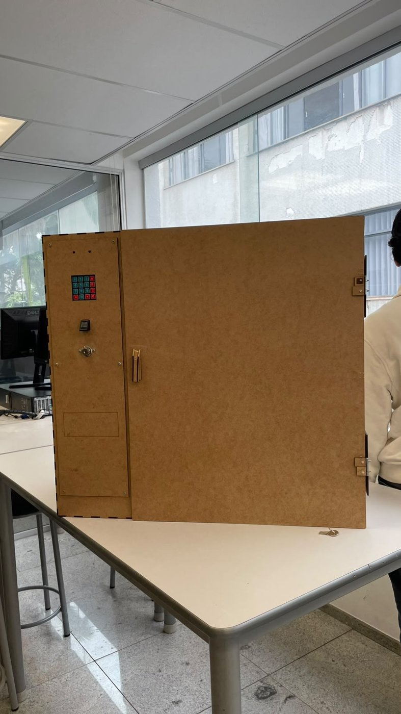
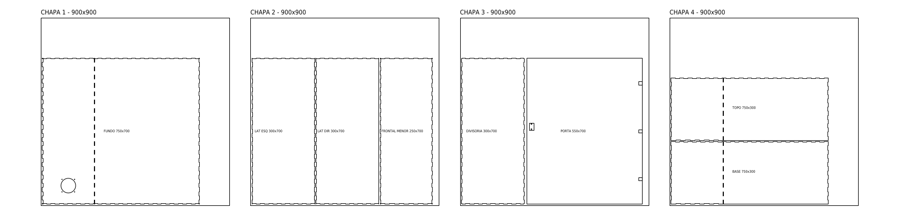

# Dispensário Eletrônico com Acesso por Biometria e Senha

Projeto acadêmico desenvolvido em parceria com o **Hospital Mário Pena**. É um dispensário eletrônico com gavetas em MDF, destinado ao uso no hospital. O acesso é liberado apenas após autenticação por **biometria** ou **senha digitada no teclado**.

> **Status:** em desenvolvimento (estrutura física montada, código em finalização).

<!-- Troque pela foto real quando tiver -->

## Como funciona

1. A pessoa digita a **senha** no **teclado 4x4** e aperta **#** para confirmar (**\*** apaga o que foi digitado). A cada tecla, o **buzzer** dá um bip curto.
2. O **Arduino Uno** compara a senha digitada com a senha cadastrada.
3. Se estiver correta, o **LED verde** acende, o buzzer toca dois bips e o **relé** manda um pulso de 1 s para a **tranca**, que destrava.
4. Se estiver incorreta, o **LED vermelho** acende, o buzzer toca um som grave e a tranca permanece fechada.

> A leitura pelo **leitor biométrico** faz parte do projeto e a ligação já está definida (veja o esquema elétrico), mas ela ainda não está no código atual, que libera só pela senha.

## Lista de materiais

### Eletrônica

| Qtd | Componente | Função |
|-----|------------|--------|
| 1 | Arduino Uno | Controlador principal |
| 1 | Leitor biométrico | Autenticação por digital |
| 1 | Teclado matricial 4x4 | Autenticação por senha |
| 1 | Tranca eletrônica | Trava da porta/gaveta |
| 1 | Módulo relé | Aciona a tranca (12 V) com sinal do Arduino |
| 1 | Fonte 12 V 3 A | Alimentação do sistema |
| 1 | Buzzer (buzina) | Sinais sonoros: tecla apertada, acesso liberado e acesso negado |
| 1 | LED verde | Indica acesso liberado |
| 1 | LED vermelho | Indica acesso negado |
| 2 | Resistores de 330 Ω | Limitam a corrente dos LEDs |
| - | Jumpers macho/fêmea | Ligações |

### Estrutura

- MDF de 3 mm cortado a laser, em chapas de 1 m × 1 m (área de corte de 900 × 900 mm)
- 10 chapas ao todo: 4 do dispensário e 6 das gavetas (1 chapa por gaveta); os trilhos e as peças extras cabem na sobra de uma chapa de gaveta
- 6 gavetas, cada uma com 2 trilhos (12 trilhos)
- 3 dobradiças douradas (micro dobradiça 15 × 11 mm, para caixa de MDF) na porta, fixadas com parafusos e presas por quadrados de MDF de 25 × 25 mm
- Cola super bonder para a união das peças
- Acabamento (**a preencher**)

A lista completa está em [`docs/lista-de-materiais.md`](docs/lista-de-materiais.md).

## Estrutura física

| Parte | C × A × L |
|-------|-----------|
| Dispensário completo | 75 × 70 × 30 cm |
| Parte das gavetas | 50 × 70 × 30 cm |
| Parte da eletrônica | 25 × 70 × 30 cm |

Os arquivos de corte a laser (oficiais) estão na pasta [`cad/`](cad/), com a lista de peças e as imagens em [`cad/README.md`](cad/README.md).

| Arquivo | Conteúdo | Quantas vezes cortar |
|---------|----------|----------------------|
| [`cad/armario/estrutura_gavetario.dxf`](cad/armario/estrutura_gavetario.dxf) | Corpo do dispensário (fundo, laterais, divisória, frontal menor, porta, topo e base), em 4 chapas, com os furos e marcações gravadas | 1 vez |
| [`cad/gavetas/gaveta.dxf`](cad/gavetas/gaveta.dxf) | **1 gaveta** | **6 vezes** (o projeto tem 6 gavetas) |
| [`cad/gavetas/trilhos_e_mais.dxf`](cad/gavetas/trilhos_e_mais.dxf) | 12 trilhos (2 por gaveta), a tampa do furo do cabo da fonte e 4 quadrados de 25 × 25 mm que prendem as dobradiças | 1 vez |

> ⚠️ O arquivo da gaveta tem **apenas uma gaveta**. Corte-o **6 vezes** para obter as 6 gavetas do projeto.

## Esquema elétrico

Ligações conforme o código atual:

| Componente | Pino do Arduino |
|------------|-----------------|
| Teclado 4x4 (linhas) | D4, D5, D6, D7 |
| Teclado 4x4 (colunas) | D8, D9, D10, D11 |
| Relé (sinal S, aciona a tranca) | D12 |
| Buzzer | + no D13, − no GND |
| LED verde (com resistor de 330 Ω) | A0 |
| LED vermelho (com resistor de 330 Ω) | A1 |
| Leitor biométrico | fio vermelho no 5V, fio preto no GND, fio amarelo no D3 e fio verde no D2 (ainda não usado no código) |

A tranca é alimentada pela fonte de 12 V através do contato do relé. O cabo da fonte sai pelo furo de Ø 70 mm no fundo do dispensário, coberto por uma tampa redonda.

## Código

O código-fonte está em [`eletronica/codigo/dispensario_eletronico/dispensario_eletronico.ino`](eletronica/codigo/dispensario_eletronico/dispensario_eletronico.ino).

Destaques:

- O teclado é lido por **interrupção** (PCINT2 nos pinos D4–D7): o Arduino só faz a varredura quando uma tecla muda de estado.
- **Antirrebote** de 20 ms e espera a tecla ser solta antes de aceitar a próxima.
- Os LEDs apagam sozinhos (verde após 3 s, vermelho após 1,5 s) usando `millis()`, sem travar o programa.
- Mensagens no Monitor Serial (9600 baud) para acompanhar o funcionamento.
- Não usa bibliotecas externas.

> A senha no código (`1234`) é **provisória**. Troque a constante `SENHA_CORRETA` antes de usar o dispensário de verdade.

Para carregar na placa:

1. Abra `dispensario_eletronico.ino` na Arduino IDE.
2. Selecione a placa **Arduino Uno** e a porta correta.
3. Clique em **Carregar**.

## Montagem

Passo a passo com fotos em [`docs/montagem.md`](docs/montagem.md).

## Possíveis melhorias

- Registro de acessos (log)
- Mais de um usuário com permissões diferentes
- Alerta sonoro para tentativas inválidas

## Equipe

- [Itallo](https://github.com/italloferreira)
- [Lara](https://github.com/Laragranato17)
- [Isabella](https://github.com/IsabellaAssiss)
- [Augusto](https://github.com/AugustoGaipo)
- [Cauan](https://github.com/Caua-Caldeira-harlle)

**Instituição:** IBMEC
**Disciplina:** Projeto de Sistemas Embarcados
**Professor:** Osmar
**Parceiro:** Hospital Mário Pena

## Licença

A definir.
