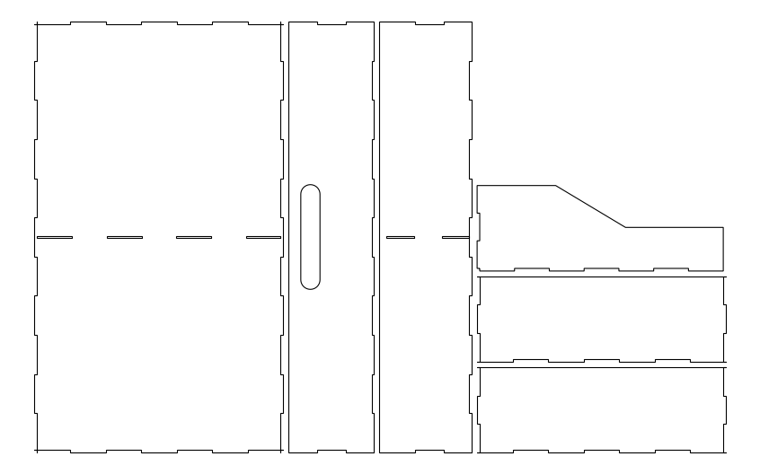
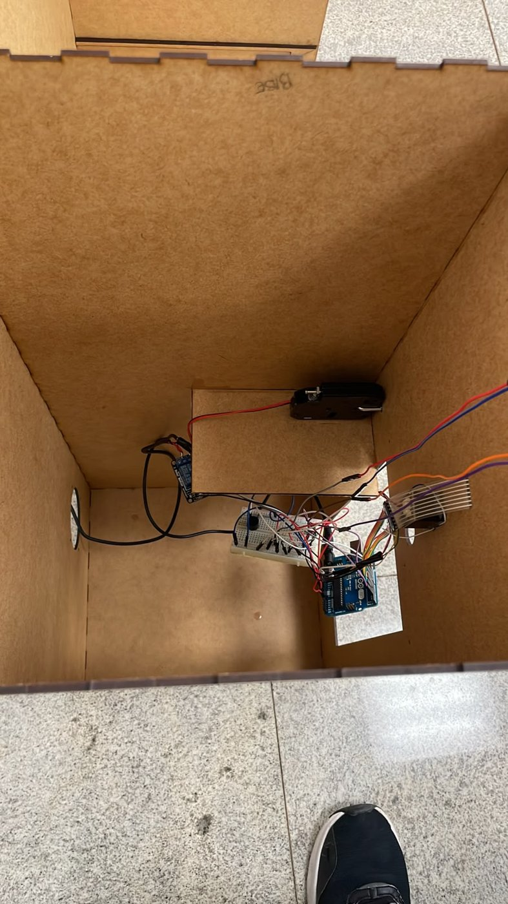

# Dispensário Eletrônico com Acesso por Biometria e Senha

Projeto acadêmico desenvolvido em parceria com o **Hospital Mário Pena**. É um dispensário eletrônico com 6 gavetas em MDF cortado a laser, destinado ao uso no hospital. A porta só destrava depois que a pessoa se identifica pela **impressão digital** ou por uma **senha digitada no teclado**.

> **Status:** protótipo montado e testado (estrutura, gavetas e eletrônica).

## Como funciona

1. **Ao ligar**, o Arduino faz um autoteste: os dois LEDs acendem por 1 s e ele procura o leitor biométrico (até 5 tentativas).
   - Leitor encontrado: o LED verde pisca 2 vezes e o LED da placa pisca devagar.
   - Leitor não encontrado: o LED vermelho pisca 3 vezes, o LED da placa pisca rápido e só a senha funciona.
2. **Pela senha:** a pessoa digita a senha no **teclado 4x4** e aperta **#** para confirmar (**\*** apaga o que foi digitado).
3. **Pela digital:** a pessoa coloca o dedo no **leitor biométrico**, que procura a digital entre as cadastradas.
4. **Acesso liberado:** o **LED verde** acende por 3 s e o **relé** manda um pulso de 1 s para a **tranca**, que destrava.
5. **Acesso negado:** o **LED vermelho** acende por 1,5 s e a tranca continua fechada.

## Lista de materiais

### Eletrônica

| Qtd | Componente | Função |
|-----|------------|--------|
| 1 | Arduino Uno | Controlador principal |
| 1 | Leitor biométrico R307S | Autenticação por digital |
| 1 | Teclado matricial 4x4 | Autenticação por senha |
| 1 | Tranca eletrônica 12 V | Trava da porta |
| 1 | Módulo relé | Aciona a tranca (12 V) com sinal do Arduino |
| 1 | Fonte 12 V 3 A | Alimentação do Arduino e da tranca |
| 1 | Buzzer (buzina) | Sinal sonoro (não usado no código atual) |
| 1 | LED verde | Indica acesso liberado |
| 1 | LED vermelho | Indica acesso negado |
| 2 | Resistores de 330 Ω | Limitam a corrente dos LEDs |
| 1 | Protoboard | Ligações |
| - | Jumpers macho/fêmea | Ligações |

### Estrutura

- MDF de 3 mm cortado a laser, em chapas de 1 m × 1 m (área de corte de 900 × 900 mm)
- 10 chapas ao todo: 4 do dispensário e 6 das gavetas (1 chapa por gaveta); os trilhos e as peças extras cabem na sobra de uma chapa de gaveta
- 6 gavetas com divisória, cada uma apoiada em 2 trilhos (12 trilhos)
- 2 dobradiças de 38 × 36 mm na porta, fixadas com parafusos
- Cola super bonder e parafusos na montagem
- Sem acabamento (MDF cru)

A lista completa está em [`docs/lista-de-materiais.md`](docs/lista-de-materiais.md).

## Estrutura física

| Parte | C × A × L |
|-------|-----------|
| Dispensário completo | 75 × 70 × 30 cm |
| Parte das gavetas | 50 × 70 × 30 cm |
| Parte da eletrônica | 25 × 70 × 30 cm |

Os arquivos de corte a laser estão na pasta [`cad/`](cad/), com a lista de peças e as imagens em [`cad/README.md`](cad/README.md).

| Arquivo | Conteúdo | Quantas vezes cortar |
|---------|----------|----------------------|
| [`cad/armario/estrutura_gavetario.dxf`](cad/armario/estrutura_gavetario.dxf) | Corpo do dispensário (fundo, laterais, divisória, frontal menor, porta, topo e base), em 4 chapas, com os furos e marcações gravadas | 1 vez |
| [`cad/gavetas/gaveta.dxf`](cad/gavetas/gaveta.dxf) | **1 gaveta** | **6 vezes** (o projeto tem 6 gavetas) |
| [`cad/gavetas/trilhos_e_mais.dxf`](cad/gavetas/trilhos_e_mais.dxf) | 12 trilhos (2 por gaveta), a tampa do furo do cabo da fonte e 4 quadrados de 25 × 25 mm | 1 vez |

> ⚠️ O arquivo da gaveta tem **apenas uma gaveta**. Corte-o **6 vezes** para obter as 6 gavetas do projeto.

## Esquema elétrico

| Componente | Pino do Arduino |
|------------|-----------------|
| Teclado 4x4 (linhas) | D4, D5, D6, D7 |
| Teclado 4x4 (colunas) | D8, D9, D10, D11 |
| Leitor biométrico (fio verde) | D2 (o Arduino recebe por aqui) |
| Leitor biométrico (fio amarelo) | D3 (o Arduino envia por aqui) |
| Leitor biométrico (fio vermelho / preto) | 5V / GND |
| Relé (sinal S, aciona a tranca) | D12 |
| LED verde (com resistor de 330 Ω) | A0 |
| LED vermelho (com resistor de 330 Ω) | A1 |
| LED "L" da placa (sinal de funcionamento) | D13 (já vem na placa) |

A fonte de 12 V alimenta o Arduino e a tranca; a tranca recebe os 12 V através do contato do relé. O cabo da fonte sai pelo furo de Ø 70 mm no fundo do dispensário, coberto por uma tampa redonda.

## Código

O código-fonte está em [`eletronica/codigo/dispensario_eletronico/dispensario_eletronico.ino`](eletronica/codigo/dispensario_eletronico/dispensario_eletronico.ino).

### Bibliotecas

| Biblioteca | Para que serve | Como instalar |
|------------|----------------|---------------|
| `Keypad` | Leitura do teclado 4x4 | Arduino IDE → Gerenciador de Bibliotecas → "Keypad" (Mark Stanley, Alexander Brevig) |
| `Adafruit_Fingerprint` | Comunicação com o leitor biométrico | Gerenciador de Bibliotecas → "Adafruit Fingerprint Sensor Library" |
| `SoftwareSerial` | Porta serial nos pinos D2 e D3 para o leitor | Já vem com a Arduino IDE |

### Destaques

- Aceita **senha ou digital**, verificando as duas a cada volta do `loop()`.
- **Autoteste** ao ligar e aviso visual se o leitor biométrico não for encontrado; nesse caso, o sistema continua funcionando só com a senha.
- **Sinal de funcionamento:** o LED da placa pisca o tempo todo usando `millis()`, sem travar o programa (devagar = tudo certo, rápido = leitor com problema).
- Depois de ler uma digital, espera o dedo sair do leitor (no máximo 2 s) para não ler a mesma digital duas vezes.
- Mensagens no Monitor Serial (9600 baud) para acompanhar o funcionamento.

> A senha no código (`1234`) é **provisória**. Troque a constante `SENHA_CORRETA` antes de usar o dispensário de verdade.

### Como carregar e cadastrar digitais

1. Instale as bibliotecas da tabela acima.
2. **Cadastre as digitais:** abra o exemplo `enroll` da biblioteca (Arquivo → Exemplos → Adafruit Fingerprint Sensor Library → enroll), carregue no Arduino e siga as instruções no Monitor Serial. Cada digital recebe um número (ID).
3. Abra `dispensario_eletronico.ino`, selecione a placa **Arduino Uno** e a porta correta e clique em **Carregar**.

## Montagem

Passo a passo com fotos em [`docs/montagem.md`](docs/montagem.md).

| | | |
|---|---|---|
|  |  |  |
| Peças cortadas | Gaveta com divisória | Eletrônica instalada |

## Possíveis melhorias

- Registro de acessos (log)
- Mais de um usuário com permissões diferentes
- Cadastro de digitais pelo próprio teclado, sem precisar do computador
- Alerta sonoro com o buzzer para tentativas inválidas

## Equipe

- [Itallo](https://github.com/italloferreira)
- [Lara](https://github.com/Laragranato17)
- [Isabella](https://github.com/IsabellaAssiss)
- [Augusto](https://github.com/AugustoGaipo)
- [Cauan](https://github.com/Caua-Caldeira-harlle)

- **Instituição:** IBMEC
- **Disciplina:** Projeto de Sistemas Embarcados
- **Professor:** Osmar
- **Parceiro:** Hospital Mário Pena

## Licença

Este projeto está sob a licença [MIT](LICENSE): qualquer pessoa pode usar, copiar e modificar, desde que mantenha o aviso com os nomes dos autores.
