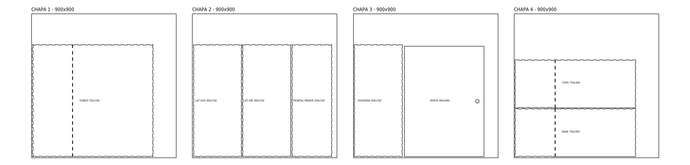
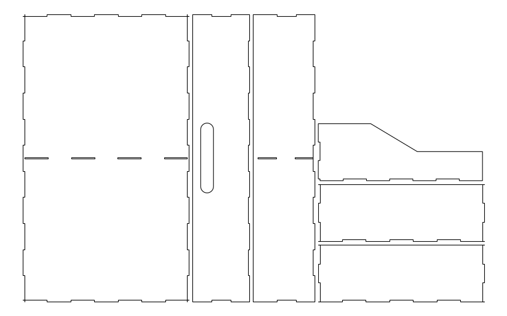

# Dispensário Eletrônico com Acesso por Biometria e Senha

Projeto acadêmico desenvolvido em parceria com o **Hospital Mário Pena**. É um dispensário eletrônico com gavetas em MDF, destinado ao uso no hospital. O acesso é liberado apenas após autenticação por **biometria** ou **senha digitada no teclado**.

> **Status:** em desenvolvimento (estrutura física montada, código em finalização).

<!-- Troque pela foto real quando tiver -->

## Como funciona

1. A pessoa se identifica pelo **leitor biométrico** ou digita a **senha** no **teclado 4x4**.
2. O **Arduino Uno** valida a credencial.
3. Se estiver correta, o **relé** aciona a **tranca** e o **LED verde** acende.
4. Se estiver incorreta, o **LED vermelho** indica a falha e a tranca permanece fechada.

## Lista de materiais

### Eletrônica

| Qtd | Componente | Função |
|-----|------------|--------|
| 1 | Arduino Uno | Controlador principal |
| 1 | Leitor biométrico | Autenticação por digital |
| 1 | Teclado matricial 4x4 | Autenticação por senha |
| 1 | Tranca eletrônica | Trava da porta/gaveta |
| 1 | Módulo relé | Aciona a tranca (12 V) com sinal do Arduino |
| 1 | Fonte 12 V 3 A | Alimentação do sistema |
| 1 | LED verde | Indica acesso liberado |
| 1 | LED vermelho | Indica acesso negado |
| 2 | Resistores de 330 Ω | Limitam a corrente dos LEDs |
| - | Jumpers macho/fêmea | Ligações |

### Estrutura

- MDF de 3 mm cortado a laser, em chapas de 1 m × 1 m (área de corte de 900 × 900 mm)
- 10 chapas ao todo: 4 do dispensário e 6 das gavetas (1 chapa por gaveta); os 12 trilhos cabem na sobra de uma chapa
- 6 gavetas, cada uma com 2 trilhos (12 trilhos)
- 4 dobradiças douradas (micro dobradiça 15 × 11 mm, para caixa de MDF), fixadas com parafusos, apenas nas portas
- Cola super bonder para a união das peças
- Acabamento (**a preencher**)

A lista completa está em [`docs/lista-de-materiais.md`](docs/lista-de-materiais.md).

## Estrutura física

| Parte | C × A × L |
|-------|-----------|
| Dispensário completo | 75 × 70 × 30 cm |
| Parte das gavetas | 50 × 70 × 30 cm |
| Parte da eletrônica | 25 × 70 × 30 cm |

Os arquivos de corte a laser (oficiais) estão na pasta [`cad/`](cad/), com a lista de peças e as imagens em [`cad/README.md`](cad/README.md).

| Arquivo | Conteúdo | Quantas vezes cortar |
|---------|----------|----------------------|
| [`cad/armario/estrutura_gavetario.dxf`](cad/armario/estrutura_gavetario.dxf) | Corpo do dispensário (fundo, laterais, divisória, frontal menor, porta, topo e base), em 4 chapas | 1 vez |
| [`cad/gavetas/gaveta.dxf`](cad/gavetas/gaveta.dxf) | **1 gaveta** | **6 vezes** (o projeto tem 6 gavetas) |
| [`cad/gavetas/trilhos.dxf`](cad/gavetas/trilhos.dxf) | 12 trilhos (2 por gaveta) | 1 vez |

> ⚠️ O arquivo da gaveta tem **apenas uma gaveta**. Corte-o **6 vezes** para obter as 6 gavetas do projeto.

## Esquema elétrico

Diagrama das ligações em [`eletronica/`](eletronica/).

Tabela de pinos (preencher conforme o código):

| Componente | Pino do Arduino |
|------------|-----------------|
| Relé (tranca) | a preencher |
| LED verde | a preencher |
| LED vermelho | a preencher |
| Teclado 4x4 (linhas) | a preencher |
| Teclado 4x4 (colunas) | a preencher |
| Leitor biométrico (TX/RX) | a preencher |

## Código

O código-fonte fica em [`eletronica/codigo/`](eletronica/codigo/).

Para carregar na placa:

1. Abra o arquivo `.ino` na Arduino IDE.
2. Instale as bibliotecas necessárias (**a preencher**, ex.: biblioteca do teclado e do leitor biométrico).
3. Selecione a placa **Arduino Uno** e a porta correta.
4. Clique em **Carregar**.

## Montagem

Passo a passo com fotos em [`docs/montagem.md`](docs/montagem.md).

## Possíveis melhorias

- Registro de acessos (log)
- Mais de um usuário com permissões diferentes
- Alerta sonoro para tentativas inválidas

## Equipe

- [Itallo](https://github.com/SEU-USUARIO) <!-- troque SEU-USUARIO pelo seu usuário do GitHub -->
- [Lara](https://github.com/Laragranato17)
- [Isabella](https://github.com/IsabellaAssiss)
- Augusto (GitHub a adicionar)
- [Cauan](https://github.com/Caua-Caldeira-harlle)

**Instituição:** IBMEC
**Disciplina:** Projeto de Sistemas Embarcados
**Professor:** Osmar
**Parceiro:** Hospital Mário Pena

## Licença

A definir.
