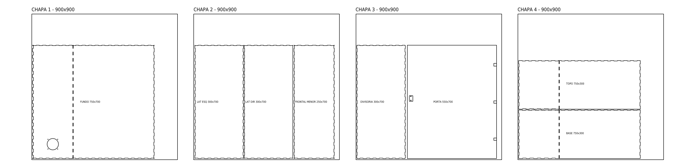
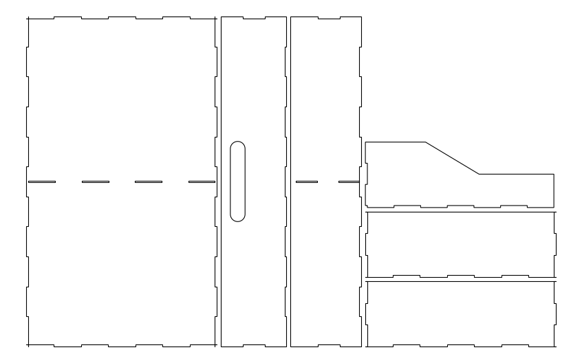
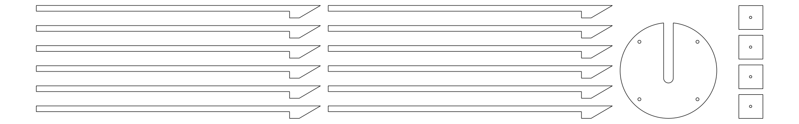

# Arquivos de corte a laser

Peças do dispensário eletrônico em MDF, prontas para o corte a laser. Estes são os **arquivos oficiais** do projeto.

- **Formato:** DXF, unidades em milímetros, camada `CORTE` (linhas de corte).
- **Material:** MDF de 3 mm, chapa de 1 m × 1 m com área de corte de **900 × 900 mm**.

| Arquivo | O que tem | Quantas vezes cortar |
|---------|-----------|----------------------|
| [`armario/estrutura_gavetario.dxf`](armario/estrutura_gavetario.dxf) | Corpo do dispensário, em 4 chapas de 900 × 900 mm | **1 vez** |
| [`gavetas/gaveta.dxf`](gavetas/gaveta.dxf) | **1 gaveta** completa (6 peças) | **6 vezes** (o projeto tem 6 gavetas) |
| [`gavetas/trilhos_e_mais.dxf`](gavetas/trilhos_e_mais.dxf) | **12 trilhos** (2 por gaveta), a tampa do furo do cabo da fonte e 4 quadrados que prendem as dobradiças | **1 vez** |

> ⚠️ **Atenção:** `gaveta.dxf` tem só uma gaveta. Para montar as 6 gavetas, corte esse arquivo 6 vezes. O arquivo dos trilhos já vem completo (12 trilhos + peças extras) e é cortado uma única vez.

## Resumo de chapas

| Item | Chapas de 900 × 900 mm |
|------|------------------------|
| Dispensário (`estrutura_gavetario.dxf`) | 4 |
| Gavetas (`gaveta.dxf` × 6) | 6 (a gaveta ocupa 792 × 494 mm, então cabe 1 por chapa) |
| Trilhos e peças extras (`trilhos_e_mais.dxf`, 752 × 118 mm) | 1 corte; cabe na sobra de uma chapa de gaveta |
| **Total** | **10 chapas** (11 se os trilhos forem cortados em chapa separada) |

## Dispensário: `estrutura_gavetario.dxf`

Camadas: `CORTE` (cortes), `GRAVAR` (marcações **gravadas**, não cortadas), `CHAPA` (contorno de cada chapa de 900 × 900 mm, só referência) e `TEXTO` (nomes das peças, só referência).

| Chapa | Peça | Medida (mm) |
|-------|------|-------------|
| 1 | Fundo | 750 × 700 |
| 2 | Lateral esquerda | 300 × 700 |
| 2 | Lateral direita | 300 × 700 |
| 2 | Frontal menor | 250 × 700 |
| 3 | Divisória | 300 × 700 |
| 3 | Porta | 550 × 700 |
| 4 | Topo | 750 × 300 |
| 4 | Base | 750 × 300 |

- **Fundo:** furo de Ø 70 mm na parte da eletrônica, com 4 furos de Ø 2,5 mm em volta (quadrado de 60 mm entre centros). Por ele passa o cabo da fonte para fora do dispensário, até a tomada. A tampa redonda de `trilhos_e_mais.dxf` é fixada sobre ele para fechar o buraco e dar acabamento; o rasgo até o centro deixa o cabo passar.
- **Porta:** 2 furos de Ø 4,2 mm (25 mm entre centros), a 23 mm da borda esquerda, com uma marcação gravada de 21 × 36 mm em volta. Eles marcam onde fica a peça de metal da tranca (a parte que prende), que será fixada com parafuso ou abraçadeira de nylon (enforca-gato), ainda a definir.
- **Dobradiças:** na borda direita da porta há 3 marcações gravadas de 15 × 15,5 mm, uma para cada uma das 3 dobradiças.
- **Encaixes:** as peças se unem por dentes; os 34 rasgos de 3 × 20 mm (18 no fundo e 16 entre o topo e a base) recebem a divisória e as demais peças. As medidas válidas são as dos arquivos.
- A porta é um retângulo liso; as demais peças têm bordas com dentes de encaixe.

## Gaveta: `gaveta.dxf` (cortar 6 vezes)

Cada corte do arquivo gera **uma gaveta** com estas peças:

| Peça | Medida (mm) | Qtd por gaveta |
|------|-------------|----------------|
| Fundo | 285 × 494 | 1 |
| Lateral (com rasgo de puxador 22 × 120 mm) | 98 × 494 | 1 |
| Lateral | 106 × 494 | 1 |
| Painel | 285 × 98 | 2 |
| Painel | 282 × 98 | 1 |
| Rasgos de encaixe | 3 × 39,9 mm (4, no fundo) e 3 × 31,7 mm (2, nas laterais) | 6 |

Para as **6 gavetas**: 36 peças grandes (6 fundos, 12 laterais, 18 painéis).

## Trilhos e peças extras: `trilhos_e_mais.dxf` (cortar 1 vez)

| Peça | Medida (mm) | Qtd |
|------|-------------|-----|
| Trilho com ponta chanfrada ("bico") | 294 × 13 | 12 (2 por gaveta) |
| Tampa do furo do cabo da fonte (rasgo até o centro para o cabo) | Ø 100, 4 furos de Ø 3,2 mm | 1 |
| Quadrado com furo central (vai por cima da dobradiça para prendê-la na porta) | 25 × 25, furo de Ø 2,5 mm | 4 |

Os 4 furos da tampa ficam na mesma posição dos 4 furos em volta do furo de Ø 70 mm do fundo.

## Pontos a confirmar

- **Nomes das peças da gaveta:** conferir qual lateral e qual painel é a frente, a traseira e os lados na montagem.
- **Fixação da tranca:** parafuso ou abraçadeira de nylon (a definir).
