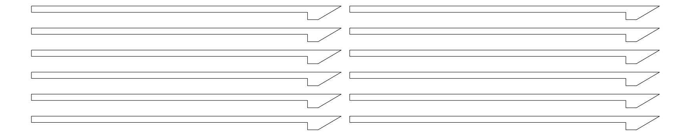

# Arquivos de corte a laser

Peças do armário eletrônico em MDF, prontas para o corte a laser. Estes são os **arquivos oficiais** do projeto.

- **Formato:** DXF, unidades em milímetros, camada `CORTE` (linhas de corte).
- **Material:** MDF de 3 mm, chapa de 1 m × 1 m com área de corte de **900 × 900 mm**.

| Arquivo | O que tem | Quantas vezes cortar |
|---------|-----------|----------------------|
| [`armario/estrutura_gavetario.dxf`](armario/estrutura_gavetario.dxf) | Corpo do armário, em 4 chapas de 900 × 900 mm | **1 vez** |
| [`gavetas/gaveta.dxf`](gavetas/gaveta.dxf) | **1 gaveta** completa (6 peças) | **6 vezes** (o projeto tem 6 gavetas) |
| [`gavetas/trilhos.dxf`](gavetas/trilhos.dxf) | **12 trilhos** (2 por gaveta) | **1 vez** |

> ⚠️ **Atenção:** `gaveta.dxf` tem só uma gaveta. Para montar as 6 gavetas, corte esse arquivo 6 vezes. Os trilhos já vêm completos (12 peças) e são cortados uma única vez.

## Resumo de chapas

| Item | Chapas de 900 × 900 mm |
|------|------------------------|
| Armário (`estrutura_gavetario.dxf`) | 4 |
| Gavetas (`gaveta.dxf` × 6) | 6 (a gaveta ocupa 792 × 494 mm, então cabe 1 por chapa) |
| Trilhos (`trilhos.dxf`, 596 × 118 mm) | 1 corte; cabe na sobra de uma chapa de gaveta |
| **Total** | **10 chapas** (11 se os trilhos forem cortados em chapa separada) |

## Armário: `estrutura_gavetario.dxf`

Camadas: `CORTE` (cortes), `CHAPA` (contorno de cada chapa de 900 × 900 mm, só referência), `TEXTO` (nomes das peças), `FECHADURA` (furo).

| Chapa | Peça | Medida (mm) |
|-------|------|-------------|
| 1 | Fundo | 750 × 700 |
| 2 | Lateral esquerda | 300 × 700 |
| 2 | Lateral direita | 300 × 700 |
| 2 | Frontal menor | 250 × 700 |
| 3 | Divisória | 300 × 700 |
| 3 | Porta | 495 × 690 |
| 4 | Topo | 750 × 300 |
| 4 | Base | 750 × 300 |

- **Furo da fechadura:** Ø 22 mm na porta (camada `FECHADURA`).
- **Encaixes:** 34 rasgos de 3 × 20 mm: 18 no fundo e 16 entre o topo e a base, para encaixar a divisória e as demais peças.
- A porta é um retângulo liso; as demais peças têm bordas com dentes de encaixe.

## Gaveta: `gaveta.dxf` (cortar 6 vezes)

Cada corte do arquivo gera **uma gaveta** com estas peças:

| Peça | Medida (mm) | Qtd por gaveta |
|------|-------------|----------------|
| Fundo | 285 × 494 | 1 |
| Lateral (com rasgo de puxador 22 × 120 mm) | 98 × 494 | 1 |
| Lateral | 106 × 494 | 1 |
| Painel | 285 × 98 | 2 |
| Painel | 282 × 98 | 1 |
| Rasgos de encaixe | 3 × 39,9 mm (4, no fundo) e 3 × 31,7 mm (2, nas laterais) | 6 |

Para as **6 gavetas**: 36 peças grandes (6 fundos, 12 laterais, 18 painéis).

## Trilhos: `trilhos.dxf` (cortar 1 vez)

12 trilhos de 294 × 13 mm com ponta chanfrada ("bico"), em duas colunas de 6. São 2 trilhos por gaveta × 6 gavetas.

## Pontos a confirmar

- **Dentes/encaixes:** as medidas informadas para os dentes (3 cm × 5 mm) não batem com os rasgos dos arquivos (3 × 20 mm no armário). Confirmar qual é a medida correta.
- **Nomes das peças da gaveta:** conferir qual lateral e qual painel é a frente, a traseira e os lados na montagem.
