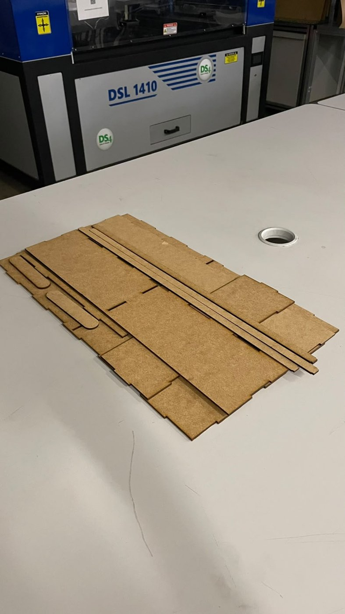
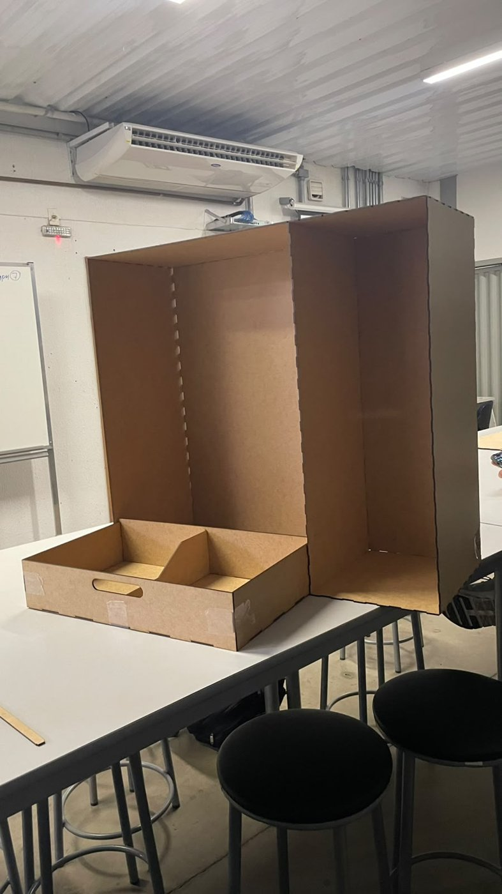
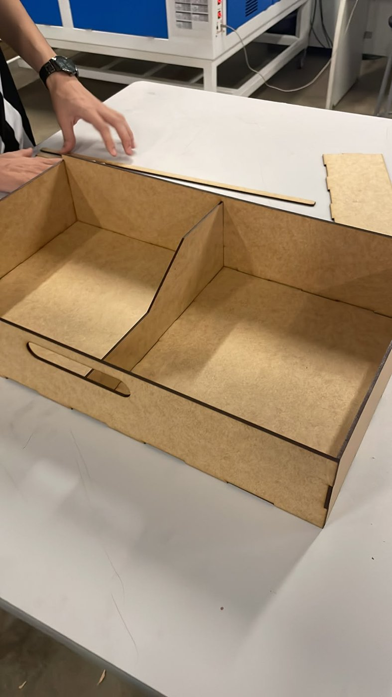
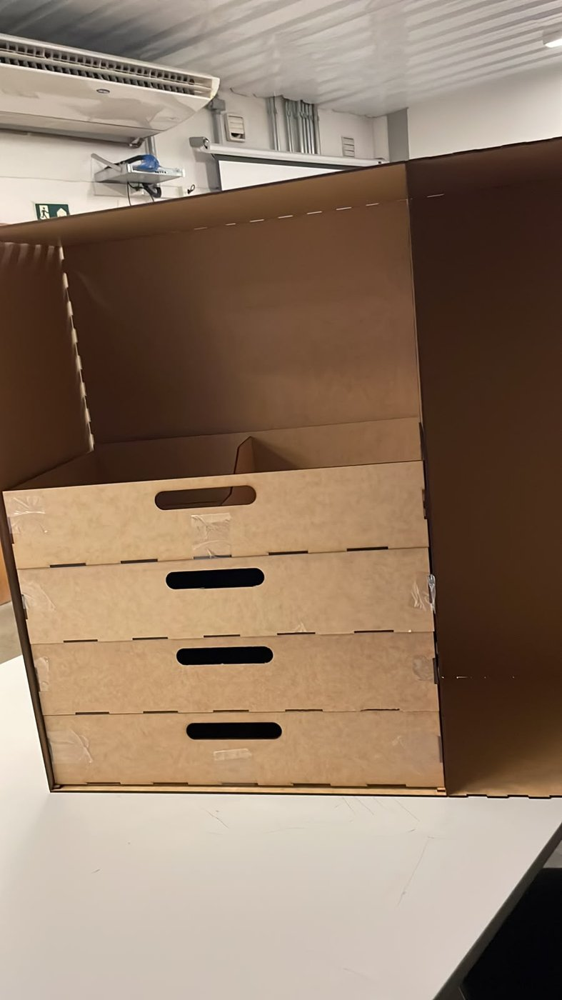
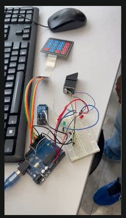
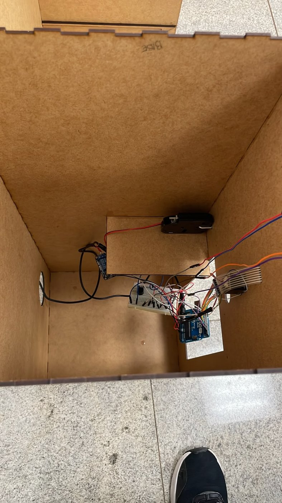

# Passo a passo da montagem

## 1. Corte do MDF

- Material: MDF de 3 mm, em chapas de 1 m × 1 m com área de corte de 900 × 900 mm.
- Dispensário: [`cad/armario/estrutura_gavetario.dxf`](../cad/armario/estrutura_gavetario.dxf), corte 1 vez (4 chapas).
- Gavetas: [`cad/gavetas/gaveta.dxf`](../cad/gavetas/gaveta.dxf) tem **1 gaveta**; corte **6 vezes** para fazer as 6 gavetas.
- Trilhos e peças extras: [`cad/gavetas/trilhos_e_mais.dxf`](../cad/gavetas/trilhos_e_mais.dxf), corte 1 vez (12 trilhos, a tampa do furo do cabo da fonte e 4 quadrados).
- O arquivo da estrutura tem a camada `GRAVAR`: essas linhas são **gravadas** (marcação), não cortadas. Configure o laser com potência de gravação para essa camada.
- Peças e medidas: veja [`cad/README.md`](../cad/README.md).

## 2. Montagem do dispensário e das gavetas

1. Monte primeiro todo o corpo do dispensário (fundo, laterais, divisória, frontal menor, topo e base), colando os encaixes com super bonder.
2. Monte as 6 gavetas, todas com a divisória no meio.
3. Cole os trilhos (travas) nas duas paredes do espaço das gavetas, um par por gaveta, nas alturas da tabela abaixo.
4. Instale a porta com as 2 dobradiças, fixadas com parafusos.
5. Passe o cabo da fonte pelo furo de Ø 70 mm do fundo e feche com a tampa redonda.

| | |
|---|---|
|  |  |
| Corpo montado e a primeira gaveta | Gaveta com a divisória |

### Altura dos trilhos

Medida do **piso interno** do dispensário (a face de cima da base) até a **face de cima** de cada par de trilhos, onde a gaveta apoia:

| Gaveta (de baixo para cima) | Altura da face de cima do trilho |
|-----------------------------|----------------------------------|
| 1 | 13 mm |
| 2 | 127 mm |
| 3 | 241 mm |
| 4 | 355 mm |
| 5 | 469 mm |
| 6 | 583 mm |

Ou seja, **114 mm** entre um par de trilhos e o próximo.

Como o cálculo foi feito:

- Altura interna do dispensário: 700 mm − 3 mm da base − 3 mm do topo = **694 mm**.
- A gaveta tem a frente com 98 mm e a traseira com 106 mm de altura. O trilho tem 6 mm de barra e um dente que desce mais 7 mm (13 mm no total).
- Com 114 mm entre os pares, a traseira da gaveta (106 mm) passa 2 mm abaixo da barra do trilho de cima, e o dente desse trilho desce 5 mm além do topo da traseira, segurando a gaveta. A frente, mais baixa (98 mm), passa 3 mm abaixo do dente.
- A gaveta de cima termina a 689 mm, deixando 5 mm de folga até o topo.

> **Antes de colar tudo**, cole um par de trilhos, coloque uma gaveta e teste se ela entra, sai e fica presa do jeito certo. Se a altura interna medida for diferente de 694 mm, as alturas precisam ser recalculadas.

## 3. Instalação da tranca

- A peça de metal da tranca (a parte que prende) vai na marcação gravada perto da borda esquerda da porta, usando os 2 furos de Ø 4,2 mm.
- Fixação com parafusos e cola super bonder.

## 4. Ligações eletrônicas

- Faça as ligações conforme a tabela de pinos do [README](../README.md#esquema-elétrico).
- O Arduino e a tranca são alimentados pela mesma fonte de 12 V; a tranca recebe os 12 V pelo contato do relé.
- O Arduino, o relé, a protoboard e a tranca ficam na parte da eletrônica (o espaço de 25 cm à esquerda).
- O teclado, o leitor biométrico e os LEDs ficam na frente da parte da eletrônica.

| | |
|---|---|
|  |  |
| Teste dos componentes na protoboard | Eletrônica instalada |

## 5. Testes

Depois de carregar o código e cadastrar pelo menos uma digital, confira os itens abaixo. Todos foram testados pela equipe no protótipo e funcionaram.

- [x] Ao ligar, os dois LEDs acendem por 1 s e o verde pisca 2 vezes (leitor encontrado).
- [x] O LED "L" da placa fica piscando devagar.
- [x] Senha certa + **#**: LED verde acende e a tranca destrava.
- [x] Senha errada + **#**: LED vermelho acende e a tranca continua fechada.
- [x] **\*** apaga o que foi digitado.
- [x] Digital cadastrada: LED verde acende e a tranca destrava.
- [x] Digital não cadastrada: LED vermelho acende e a tranca continua fechada.
- [x] Com o leitor desligado, o vermelho pisca 3 vezes ao ligar e a senha continua funcionando.
